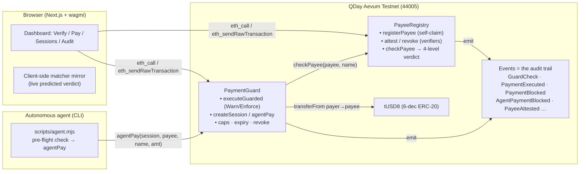

<div align="center">

# 🛡 PaySentry

**Trustless Confirmation of Payee for the agentic economy.**

Check first. Pay second. Always.

Built for the **[QDay Aevum Builder Challenge #1](https://dorahacks.io/hackathon/qday)** · Confirmation of Payee track · QDay Aevum Testnet (chain 44005) · tUSD8

[Live Demo](https://paysentry.vercel.app) · [Guided Demo Flow](#-demo-day-script) · [Architecture](#-architecture) · [Deploy](#-deploy-your-own)

</div>

---

## What is this?

Banks solved "am I paying the right account?" years ago with **Confirmation of Payee** (UK, 2020) and **Verification of Payee** (EU, mandatory since Oct 2025). Blockchain — where transfers are irreversible and AI agents are starting to pay autonomously — has nothing equivalent.

**PaySentry brings that safety rail on-chain:**

1. **PayeeRegistry** — payees claim an identity on-chain; trusted verifiers endorse `address → name` pairs (a federated trust model). 
2. **PaymentGuard** — every payment runs the CoP check first. `FULL MATCH` proceeds, `CLOSE MATCH` warns, `NO MATCH` / `NOT FOUND` **revert the transaction on-chain** before any token moves.
3. **Bounded agent sessions** — give an AI agent a scoped session (per-tx limit, lifetime cap, expiry, instant revocation). Limits are enforced by the contract at execution time, not by the agent's code. Agents are **always enforced** — the guard physically cannot execute a mismatched payment.

Every check, execution and blocked attempt emits events → a permanent, verifiable audit trail with zero backend and zero databases. **The chain is the database.**

---

## ✅ Judging criteria — how we score 100

| Criterion (weight) | How PaySentry addresses it |
|---|---|
| **Innovation & originality (20)** | First trustless Confirmation-of-Payee for agent payments. Federated verifier attestations instead of a centralized name service. The on-chain revert-as-audit-evidence pattern (a *blocked payment is itself fraud evidence*) is novel. |
| **Technical quality & platform integration (15)** | Zero-dependency Solidity (no OZ import risk), bounded-gas matching (64-char cap, two-row Levenshtein), reentrancy guards, custom errors, least-privilege sessions enforced at the EntryPoint-equivalent execution layer, 28 Foundry tests incl. a fuzz test on the matcher. |
| **UX & presentation (15)** | Live predicted-verdict chips as you type (client-side mirror of the contract logic), animated verdict cards, plain-language error toasts, wrong-network prompts, mobile-responsive dark UI with a 3D particle hero. |
| **Real-world utility (15)** | Mirrors UK/EU CoP semantics that banks already run; targets APP-fraud / invoice-redirect scams and prompt-injected agent payments. Realistic merchant + agent workflow; contracts are a drop-in guard for any checkout or invoice flow. |
| **Safety, trust & controls (15)** | Warn vs Enforce modes, agents always enforced, hard per-tx + lifetime caps, session expiry, instant revocation, no custodied funds (`transferFrom` straight payer→payee), full on-chain audit trail, no key material anywhere. |
| **Demo clear & well-structured (10)** | A 6-step in-app guided demo (`/demo`) plus a scripted agent CLI (`scripts/agent.mjs`) that first *self-aborts* on a mismatch — then shows the guard reverting a forced attempt. Every step ends with an explorer link. |
| **Documentation (10)** | This README: architecture diagram, per-contract spec, turnkey deploy steps, agent usage, known limitations, roadmap. |
| **Ecosystem contribution (10)** | MIT-licensed, dependency-free contracts designed for reuse (any checkout/invoice/agent flow can integrate `checkPayee` + `executeGuarded`). Reusable agent CLI. Actionable platform feedback in the docs. |

---

## 🏗 Architecture



**Verdict semantics** (mirroring UK CoP):

| Verdict | Meaning | Guard behavior (Enforce) |
|---|---|---|
| `FULL MATCH` (3) | Names identical after normalization | ✅ proceeds |
| `CLOSE MATCH` (2) | Typo-level Levenshtein distance | ✅ proceeds, flagged |
| `NO MATCH` (1) | Address known, name wrong | ❌ **reverts on-chain** |
| `NOT FOUND` (0) | Address has no identity at all | ❌ **reverts on-chain** |

Normalization: ASCII-lowercase, punctuation stripped, whitespace collapsed — `"  Budi  Santoso!!!"` ≡ `"budi santoso"`. Close-match tolerance is length-tiered (≥24 chars → distance ≤3; ≥12 → ≤2; ≥5 → ≤1; shorter → exact only).

---

## 📂 Repository layout

```
paysentry/
├── contracts/                  # Foundry project (zero external deps besides forge-std)
│   ├── src/PayeeRegistry.sol   # Identity registry + the checkPayee primitive
│   ├── src/PaymentGuard.sol    # CoP-gated payments + bounded agent sessions
│   ├── src/token/IERC20.sol    # Vendored minimal interface
│   ├── src/utils/ReentrancyGuard.sol
│   ├── test/PaySentry.t.sol    # 28 tests (matching, guard, sessions, fuzz)
│   └── script/Deploy.s.sol     # Deploys both, saves deployments/<chainId>.json
└── app/                        # Next.js 14 + wagmi v2 + RainbowKit + R3F + framer-motion
    ├── src/lib/web3/           # chain config, ABIs, addresses, providers
    ├── src/lib/cop/simulate.ts # TS mirror of the on-chain matcher (live predictions)
    ├── src/components/         # landing (3D hero), dashboard panels, demo wizard
    └── scripts/agent.mjs       # the autonomous-agent CLI
```

---

## 🚀 Deploy your own

### 1. Prerequisites

- Node.js ≥ 18, Git
- [Foundry](https://book.getfoundry.sh/) (`forge`, `cast`)
- MetaMask (or any injected wallet)

### 2. Test funds

Add the QDay Aevum Testnet to your wallet (chain ID **44005**, RPC `https://rpc-test.qday.info`) and claim **tQDAY** (gas) + **tUSD8** from the [faucet](https://faucet.qday.info/en). Claim for **3–4 addresses** (payer, payee, agent) — the faucet has a cooldown.

### 3. Deploy the contracts

```bash
cd contracts
export DEPLOYER_PRIVATE_KEY=0x...        # a wallet you own — never commit this
forge script script/Deploy.s.sol \
  --rpc-url https://rpc-test.qday.info \
  --broadcast
```

This deploys `PayeeRegistry` + `PaymentGuard` (deployer becomes the first verifier) and writes `deployments/44005.json`.

### 4. Configure & run the app

```bash
cd ../app
cp .env.example .env.local
# paste NEXT_PUBLIC_REGISTRY_ADDRESS / NEXT_PUBLIC_GUARD_ADDRESS from the deploy output
npm install
npm run dev        # http://localhost:3000
```

### 5. Run the agent

```bash
cd app
export AGENT_PRIVATE_KEY=0x<agent wallet key>
export GUARD_ADDRESS=0x<guard>
export REGISTRY_ADDRESS=0x<registry>
node scripts/agent.mjs inspect --session 0
node scripts/agent.mjs pay --session 0 --payee 0x<PAYEE> --name "Warung Maju Jaya" --amount 2
```

### 6. Ship the frontend

Deploy `app/` to Vercel (root directory: `app`), set the `NEXT_PUBLIC_*` env vars in the project settings. No server, no database — a static Next.js app reading public RPC.

---

## 🎬 Demo Day script

Open **`/demo`** in the app — a 6-step guided flow with copy-paste commands:

1. **Setup** — connect wallet, switch network, faucet tokens for payer/payee/agent.
2. **Register** — payee claims `"Warung Maju Jaya"` (self-claimed).
3. **Attest** — the verifier endorses it → identity level becomes **ATTESTED**.
4. **Verify** — a `FULL MATCH` verdict… then a one-character typo drops it to `CLOSE MATCH`.
5. **Agent session** — bounded session (e.g. max 5 tUSD8/tx, 50 total, 7 days). Run the agent: it pre-flight-checks the payee, sees `FULL MATCH`, pays — receipt lands on-chain.
6. **The scam attempt** — same command with an impostor name. The agent *self-aborts*; with `--force` the guard **reverts the transaction on-chain**. Open the Audit tab: the blocked attempt is permanent public evidence.

---

## 🔒 Security notes

- **No custody** — the guard never holds tokens; payments are `transferFrom(payer → payee)` immediately after the check. An approval covers exactly what the user intends to move.
- **Session limits are on-chain** — per-tx, lifetime cap, expiry and revocation are checked in `agentPay` *before* the token transfer, enforced by the contract regardless of agent behavior.
- **Agents cannot bypass the check** — there is no non-guarded path through `PaymentGuard`.
- **Bounded gas** — names are capped at 64 normalized chars; worst-case matcher cost is a few hundred kGas (measured in tests).
- **Every attempt is auditable** — `GuardCheck` fires for *every* check (even in Warn mode and even when blocked), `PaymentBlocked` / `AgentPaymentBlocked` record failures permanently.

## ⚠️ Known limitations & honest scope

- The verifier set is deployed-managed today — a real deployment would add verifier onboarding, staking/slash for attestations, and multi-party quorum.
- Matching is ASCII-only and English-style; i18n normalization (Unicode folding, transliteration) is roadmap.
- `checkPayee` compares against self-claimed + attested names; there is no KYC gate — trust derives from *who attests*, which is the point of the federated model.
- The QDay SDK / Agent APIs are planned for mainnet (Q1 2027); PaySentry deliberately builds on raw EVM primitives so it works today and ports unchanged.

## 🗺 Roadmap

1. Verifier reputation with stake-weighted attestations (ERC-8004 Reputation-style).
2. Cross-payee trust graph: "3 of 5 verifiers endorse" threshold rules.
3. SDK package (`paysentry-sdk`) — one-line `guardPay()` for any dapp checkout.
4. Paymaster integration: gasless guarded payments via ERC-4337 smart accounts.
5. On-chain dispute/flag flow with reputation halving.

## 🙏 Built on

- **QDay Aevum** — post-quantum, EVM-compatible testnet for the agentic economy
- **tUSD8** — the challenge stablecoin (ERC-20, 6 decimals)
- Foundry · Next.js · wagmi/viem · RainbowKit · react-three-fiber · framer-motion

## License

MIT — see [LICENSE](./LICENSE). Build on it, fork it, ship it.
